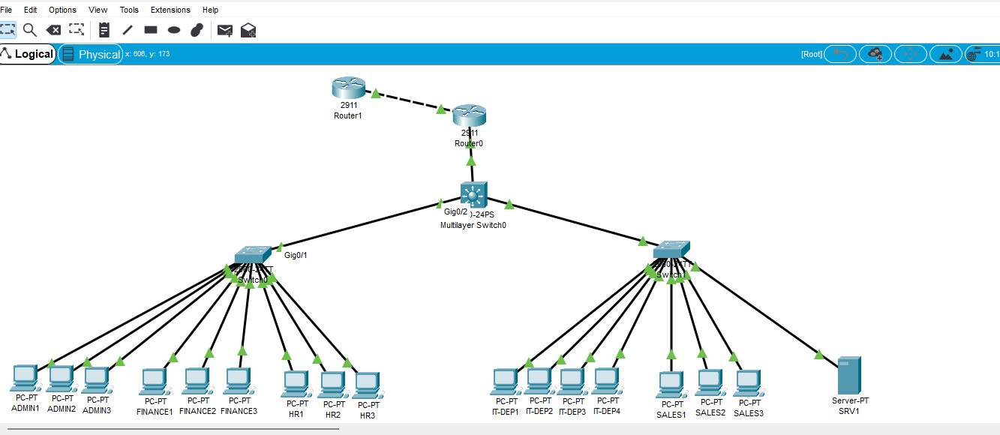
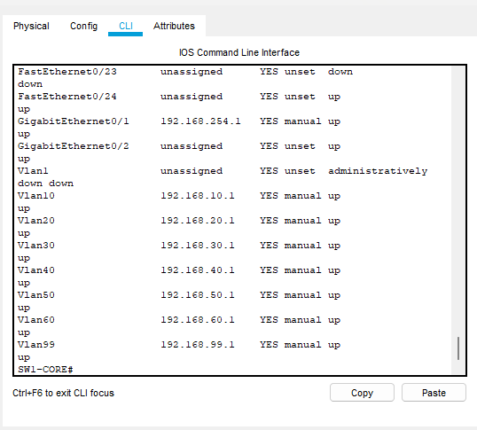
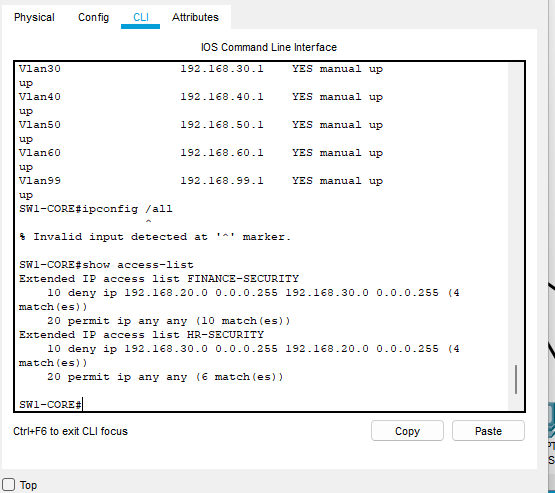
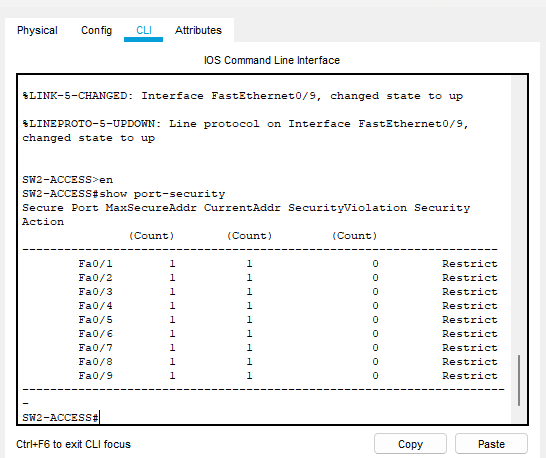
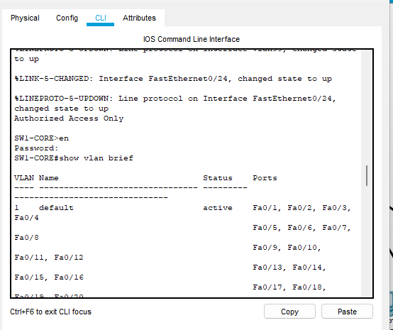
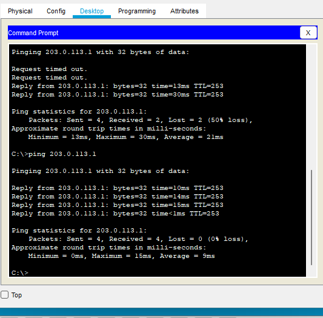
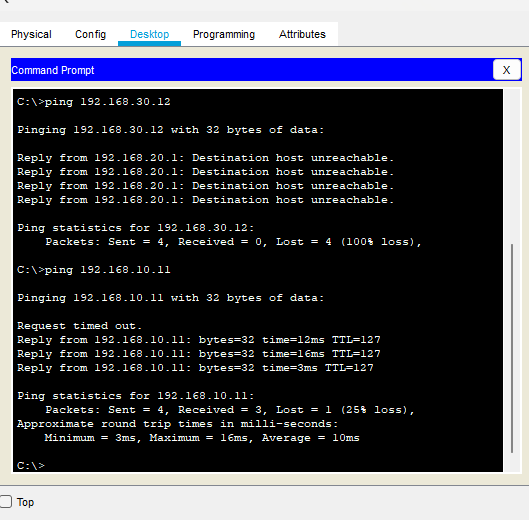
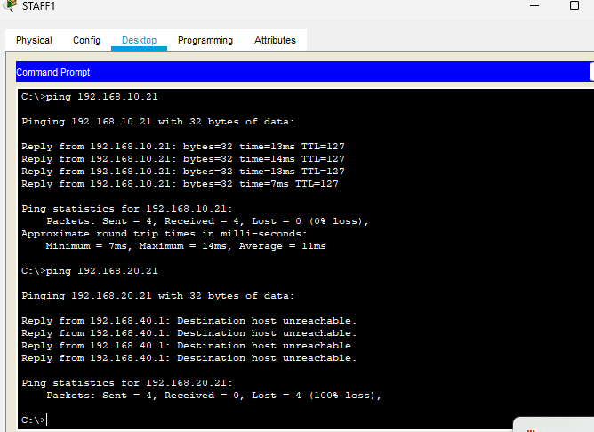
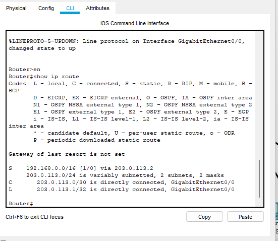

 Enterprise Ltd – Enterprise Network Design and Implementation
 Project Overview

The  Enterprise Ltd Network Project involves designing, configuring, and implementing a secure and scalable enterprise network infrastructure using Cisco Packet Tracer.

The network supports different departments through VLAN segmentation, inter-VLAN routing, DHCP, Access Control Lists (ACLs), port security, SSH remote management, and simulated WAN connectivity.

 Table of Contents

- Project Objectives
- Network Topology
- Network Devices
- VLAN and IP Addressing Plan
- Network Implementation
- Network Testing and Verification
- Challenges and Solutions
- Skills Gained
- Limitations and Future Improvements
-Tools and Technologies
- Project Folder Structure
- Conclusion
- Project Information

Project Objectives

- Design an enterprise network using Cisco Packet Tracer.
- Separate departments using VLANs.
- Configure trunk links between switches.
- Enable permitted inter-VLAN communication.
- Configure DHCP for automatic IP address allocation.
- Apply ACLs to control communication between departments.
- Configure port security on departmental access ports.
- Enable SSH for secure remote administration.
- Configure static routing to a simulated ISP.
- Test and troubleshoot network connectivity.

Network Topology

The network consists of an enterprise router, a simulated ISP router, one core multilayer switch, two access switches, departmental computers, and a server.

Network Devices

| Device | Model | Function |
|---|---|---|
| R1 | Cisco 2911 | Enterprise router |
| ISP Router | Cisco 2911 | Simulated ISP connectivity |
| SW1-CORE | Cisco 3560 | Core switching and inter-VLAN routing |
| SW2-ACCESS | Cisco 2960 | Department access connectivity |
| SW3-ACCESS | Cisco 2960 | Department access connectivity |
| PCs | End devices | Department users |
| Server | Server-PT | Server network |

VLAN and IP Addressing Plan

| VLAN ID | Department | Network Address | Default Gateway |
|---|---|---|---|
| 10 | ADMIN | 192.168.10.0/24 | 192.168.10.1 |
| 20 | FINANCE | 192.168.20.0/24 | 192.168.20.1 |
| 30 | HR | 192.168.30.0/24 | 192.168.30.1 |
| 40 | IT | 192.168.40.0/24 | 192.168.40.1 |
| 50 | SALES | 192.168.50.0/24 | 192.168.50.1 |
| 60 | SERVERS | 192.168.60.0/24 | 192.168.60.1 |
| 99 | MANAGEMENT | 192.168.99.0/24 | 192.168.99.1 |

 Network Implementation

 1. VLAN Configuration
Created seven VLANs to logically separate departments and the management network.

2. Trunk Configuration
Configured trunk links between the core switch and access switches to carry multiple VLANs.

3. Inter-VLAN Routing
Configured Switch Virtual Interfaces (SVIs) on the multilayer switch to enable routing between VLANs according to the access policies.

4. DHCP Configuration
Configured DHCP pools on the core switch to automatically assign IP addresses to computers in the ADMIN, FINANCE, HR, IT, and SALES departments.

 5. Access Control Lists (ACLs)
Configured extended ACLs to block traffic between FINANCE and HR while permitting other traffic according to the configured rules.

 6. Port Security
Configured port security on selected departmental access ports using sticky MAC address learning, a maximum of one MAC address per configured port, and restrict violation mode.

 7. SSH Remote Management
Enabled SSH version 2 for secure remote administration of network devices.

 8. WAN Connectivity and Static Routing
Configured a point-to-point connection between the enterprise router and a simulated ISP router.

| Device | Interface | IP Address |
|---|---|---|
| ISP Router | G0/0 | 203.0.113.1/30 |
| R1 | G0/0 | 203.0.113.2/30 |
| SW1-CORE | G0/1 | 192.168.254.1/30 |
| R1 | G0/1 | 192.168.254.2/30 |

Static routes were configured to support connectivity between the enterprise LAN and the simulated ISP network.

 Network Testing and Verification

The following tests were performed based on the implemented configurations:

| Test | Expected Result | Observed Result |
|---|---|---|
| PC to default gateway | Successful communication | Passed |
| DHCP address allocation | Automatic IP assignment | Passed |
| FINANCE to HR | Communication blocked | Passed |
| HR to FINANCE | Communication blocked | Passed |
| FINANCE to ADMIN | Communication allowed | Passed |
| SSH remote access | Secure access successful | Passed |
| ADMIN PC to simulated ISP | Connectivity successful | Passed |

 FINANCE to HR
The FINANCE computer was tested against the HR computer. Communication was blocked by the configured ACL.

 FINANCE to ADMIN
The FINANCE computer successfully communicated with the ADMIN computer, confirming that this permitted traffic was allowed.

 Routing Table Verification
The routing table was inspected to verify the configured network routes.

 Challenges and Solutions

| Challenge | Solution |
|---|---|
| VLAN communication problems | Configured VLANs and trunk links |
| DHCP address allocation issues | Configured DHCP pools and excluded gateway addresses |
| Unwanted communication between departments | Applied extended ACL rules |
| Unauthorized device access | Configured port security |
| Secure remote administration | Enabled SSH version 2 |
| WAN connectivity problems | Configured interface addressing and static routes |

Skills Gained

- Enterprise network design and implementation.
- Cisco router and switch configuration.
- VLAN creation and management.
- Trunk configuration and inter-VLAN routing.
- DHCP configuration.
- Network traffic control using ACLs.
- Switch port security.
- SSH remote administration.
- Static routing.
- Network troubleshooting and verification.

 Limitations and Future Improvements

Possible future improvements include:

- Implementing dynamic routing protocols such as OSPF.
- Configuring firewall security.
- Adding network monitoring.
- Adding redundant network links.
- Configuring and fully testing server services such as DNS.
- Expanding the network to support additional departments and users.

 Tools and Technologies

| Tool / Technology | Purpose |
|---|---|
| Cisco Packet Tracer | Network design and simulation |
| Cisco IOS CLI | Router and switch configuration |
| VLAN | Network segmentation |
| DHCP | Automatic IP allocation |
| ACL | Network traffic control |
| SSH | Secure remote administration |
| Port Security | Access port protection |
| Static Routing | Route configuration |

 Conclusion
The Enterprise Ltd Network Project demonstrates the design and implementation of a segmented and manageable enterprise network using Cisco Packet Tracer.
The implementation of VLANs, inter-VLAN routing, DHCP, ACLs, port security, SSH, and static routing provided practical experience in enterprise network administration and troubleshooting.

Project Information
- Project:  Enterprise Ltd – Enterprise Network Design and Implementation
- Author: [NEHEMIA NDONI]
- Course: Information Technology
- Tools: Cisco Packet Tracer
- Project Type: Academic / Practical Networking Project

> Note: The ISP connection is simulated using a Cisco router in Packet Tracer. It is not a live Internet connection.

Developed for learning, practical experience, and networking portfolio purposes.
